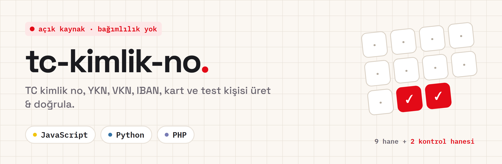
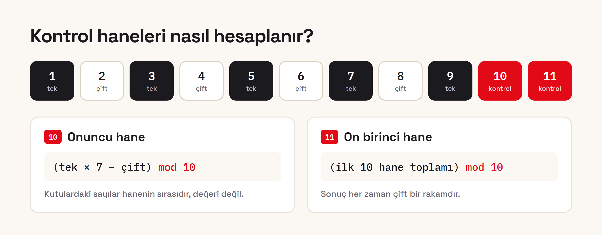

<p align="center">
  
</p>

<p align="center"><a href="README.md">Türkçe</a> · <b>English</b></p>

**tc-kimlik-no** is a small, dependency-free library for generating and validating test values specific to Türkiye. The same API is available in **JavaScript**, **Python** and **PHP**.

When you build sign-up forms, invoicing screens or checkout pages for the Turkish market, using real people's national ID numbers, IBANs or card numbers in tests is a security and privacy (KVKK) risk. This library produces values that pass the official checksum rules but are **not intended to belong to anyone**.

> Prefer a browser? The same tools are available as an [online Turkish ID number generator](https://tc-uret.com/) and a [free test value API](https://tc-uret.com/api/).

## Features

| Module | Generate | Validate | Notes |
|---|:-:|:-:|---|
| **Turkish ID number (TCKN)** | ✓ | ✓ | bulk unique generation, per-rule explanation, complete from first 9 digits |
| **Foreigner ID number (YKN)** | ✓ | ✓ | numbers starting with 99 |
| **Tax ID number (VKN)** | ✓ | ✓ | 10 digits, Revenue Administration check digit |
| **TR IBAN** | ✓ | ✓ | MOD-97, bank selection, bank name lookup, formatting |
| **Card number** | ✓ | ✓ | Luhn; Visa, Mastercard, Amex, Troy |
| **Official test cards** | — | — | iyzico and Stripe sandbox cards with result codes |
| **Test person** | ✓ | — | name, surname, TCKN, birth date, phone, email, address, IBAN |
| **Export** | — | — | JSON, CSV and SQL `INSERT` |

## Install

```bash
npm install github:serindocs/tc-kimlik-no                                     # JavaScript (Node 18+)
pip install "git+https://github.com/serindocs/tc-kimlik-no#subdirectory=python"  # Python 3.8+
```

For PHP 8.1+, copy `php/TcKimlikNo.php` or add the repository to Composer as a VCS source.

## Usage

```js
import { tckn, vkn, iban, card, person, exporter } from 'tc-kimlik-no';

tckn.generate();                    // valid 11-digit Turkish ID number
tckn.validate('12345678901');       // false
tckn.explain('12345678901');        // which rule failed
vkn.generate();                     // 10-digit tax ID
iban.generate({ bank: '00062' });   // TR IBAN for Garanti BBVA
card.generate({ network: 'troy' }); // Luhn-valid card number
exporter.sql(person.bulk(50), 'customers');
```

## How the Turkish ID checksum works

<p align="center"></p>

1. 11 digits, the first digit is never `0`.
2. **Digit 10:** (sum of digits 1, 3, 5, 7, 9 × 7 − sum of digits 2, 4, 6, 8) mod 10.
3. **Digit 11:** (sum of the first 10 digits) mod 10. It is always even.

A step-by-step interactive walkthrough with code in 8 languages is available on the [Turkish ID number algorithm](https://tc-uret.com/tc-kimlik-no-algoritmasi) page (Turkish).

## Disclaimer

For software development and testing only. Generated values are random and do not represent any person. Using them for identification, documents, payments or any official process is prohibited.

## License

[MIT](LICENSE)
