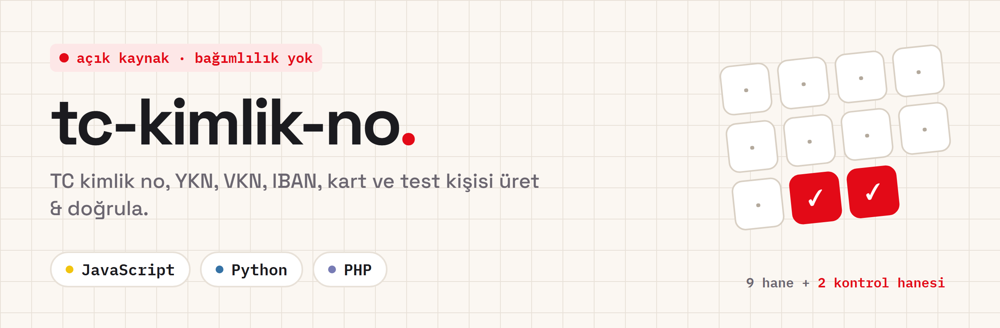
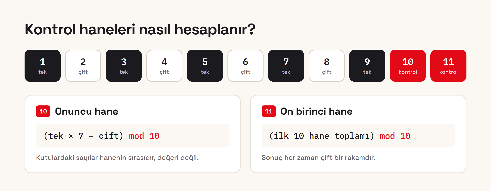

<p align="center">
  
</p>

<p align="center">
  <a href="https://github.com/serindocs/tc-kimlik-no/actions/workflows/test.yml"></a>
  
  
  
</p>

<p align="center"><b>Türkçe</b> · <a href="README.en.md">English</a></p>

**tc-kimlik-no**, yazılım testlerinde ihtiyaç duyulan Türkiye'ye özgü verileri üretmek ve doğrulamak için hazırlanmış, bağımlılığı olmayan küçük bir kütüphanedir. Aynı API'yi **JavaScript**, **Python** ve **PHP** ile sunar.

Kayıt formu, fatura ekranı ya da ödeme sayfası geliştirirken gerçek kişilerin TC kimlik numaralarını, IBAN'larını veya kart numaralarını kullanmak hem güvenlik hem de KVKK açısından risklidir. Bu kütüphane, kurallara uyan ama **hiçbir kişiye ait olması amaçlanmayan** test verisi üretir.

> Kod yazmadan denemek istersen aynı işlemleri tarayıcıda yapan bir [online TC kimlik no üretici](https://tc-uret.com/) de kullanabilirsin.

## İçindekiler

- [Özellikler](#özellikler)
- [Kurulum](#kurulum)
- [Kullanım](#kullanım)
- [Komut satırı](#komut-satırı)
- [TC kimlik no algoritması](#tc-kimlik-no-algoritması)
- [VKN, IBAN ve Luhn](#vkn-iban-ve-luhn)
- [Resmi sanal POS test kartları](#resmi-sanal-pos-test-kartları)
- [Tarayıcıdan ve API ile kullanım](#tarayıcıdan-ve-api-ile-kullanım)
- [Sorumluluk](#sorumluluk)

## Özellikler

| Modül | Üret | Doğrula | Ek |
|---|:-:|:-:|---|
| **TC kimlik no (TCKN)** | ✓ | ✓ | toplu ve benzersiz üretim, kural kural açıklama, ilk 9 haneden tamamlama |
| **Yabancı kimlik no (YKN)** | ✓ | ✓ | 99 ile başlayan numaralar |
| **Vergi kimlik no (VKN)** | ✓ | ✓ | 10 haneli, GİB kontrol hanesi |
| **TR IBAN** | ✓ | ✓ | MOD-97, banka seçimi, banka adını bulma, 4'lü biçimleme |
| **Kart numarası** | ✓ | ✓ | Luhn; Visa, Mastercard, Amex, Troy |
| **Resmi test kartları** | — | — | iyzico ve Stripe sandbox kartları, sonuç kodlarıyla |
| **Test kişisi** | ✓ | — | ad, soyad, TCKN, doğum tarihi, telefon, e-posta, adres, IBAN |
| **Dışa aktarma** | — | — | JSON, CSV ve SQL `INSERT` |

- Rastgelelik için kriptografik kaynak kullanılır (`crypto.getRandomValues`, `secrets`, `random_int`).
- E-posta adresleri, test için ayrılmış `example.com` alan adını kullanır (RFC 2606).
- SQL çıktısında tablo ve sütun adları doğrulanır, değerler kaçışlanır.
- Üç dilin her biri için testler vardır ve her push'ta GitHub Actions'ta çalışır.

## Kurulum

**JavaScript** (Node 18+, ES modülü)

```bash
npm install github:serindocs/tc-kimlik-no
```

**Python** (3.8+)

```bash
pip install "git+https://github.com/serindocs/tc-kimlik-no#subdirectory=python"
```

**PHP** (8.1+): `php/TcKimlikNo.php` dosyasını projene kopyala ya da Composer ile ekle:

```bash
composer config repositories.tc-kimlik-no vcs https://github.com/serindocs/tc-kimlik-no
composer require serindocs/tc-kimlik-no:dev-main
```

## Kullanım

### JavaScript

```js
import { tckn, ykn, vkn, iban, card, person, exporter } from 'tc-kimlik-no';

tckn.generate();              // algoritmaya uygun 11 haneli numara
tckn.bulk(1000);              // 1000 benzersiz numara
tckn.validate('12345678901'); // false
tckn.explain('12345678901');  // { valid, rules: { length, firstNotZero, digit10, digit11 } }
tckn.checkDigits('123456789');// [5, 0]

ykn.generate();               // 99 ile başlayan yabancı kimlik no
vkn.generate();               // 10 haneli vergi kimlik no

iban.generate({ bank: '00062' }); // Garanti BBVA kodlu TR IBAN
iban.format(iban.generate());     // "TRxx xxxx xxxx ..." biçiminde
iban.bankName('TR..');            // "Garanti BBVA"

card.generate({ network: 'troy' }); // Luhn uyumlu 16 haneli numara
card.luhn('4242424242424242');      // true

const kisiler = person.bulk(50, { gender: 'female' });
exporter.csv(kisiler);
exporter.sql(kisiler, 'musteriler');
```

### Python

```python
import tc_kimlik_no as t

t.tckn_generate()
t.tckn_bulk(1000)
t.tckn_validate("12345678901")      # False
t.vkn_generate()
t.iban_generate(bank="00064")       # İş Bankası
t.card_generate("mastercard")
kisiler = [t.person_generate() for _ in range(50)]
print(t.to_sql(kisiler, "musteriler"))
```

### PHP

```php
require 'php/TcKimlikNo.php';

TcKimlikNo::tcknGenerate();
TcKimlikNo::tcknValidate('12345678901'); // false
TcKimlikNo::vknGenerate();
TcKimlikNo::ibanGenerate('00010');       // Ziraat Bankası
TcKimlikNo::cardGenerate('amex');
echo TcKimlikNo::toCsv([TcKimlikNo::personGenerate(), TcKimlikNo::personGenerate()]);
```

## Komut satırı

```bash
npx github:serindocs/tc-kimlik-no tckn 5
npx github:serindocs/tc-kimlik-no kisi 20 --format csv > kisiler.csv
npx github:serindocs/tc-kimlik-no iban 3
npx github:serindocs/tc-kimlik-no dogrula 12345678901
```

Biçimler: `txt` (varsayılan), `json`, `csv`, `sql`.

## TC kimlik no algoritması

<p align="center"></p>

TC kimlik numarası 11 hanedir. İlk 9 hane nüfus sisteminden gelir, son 2 hane bu 9 haneden hesaplanır:

1. Numara 11 hanedir ve ilk hane `0` olamaz.
2. **10. hane:** tek sıradaki hanelerin (1, 3, 5, 7, 9) toplamı 7 ile çarpılır, çift sıradakilerin (2, 4, 6, 8) toplamı çıkarılır. Sonucun 10'a göre kalanı 10. hanedir.
3. **11. hane:** ilk 10 hanenin toplamının 10'a göre kalanıdır.

İki kontrol hanesi birlikte açıldığında 11. hane, tek sıradaki hanelerin toplamının 8 katının son basamağına eşit olur. Bu yüzden **son hane her zaman çifttir**. Tek bir kontrolle yanlış yazılmış birçok numara anında elenebilir.

Kütüphanedeki `explain()` fonksiyonu her kuralı ayrı ayrı döndürür. Böylece formda kullanıcıya "10. hane hatalı" gibi net bir mesaj gösterebilirsin. Hesabın adım adım, etkileşimli anlatımı ve 8 dilde hazır kod örnekleri için [TC kimlik no algoritması](https://tc-uret.com/tc-kimlik-no-algoritmasi) sayfasına bakabilirsin.

> Algoritmaya uyan bir numara, gerçek bir kişiye ait olduğu anlamına gelmez. Kimlik doğrulaması yalnızca resmi kayıtlar üzerinden yapılabilir.

## VKN, IBAN ve Luhn

**Vergi kimlik no (VKN):** 10 hanedir. Son hane, ilk 9 haneye uygulanan ağırlıklı bir hesapla bulunur. `vkn.complete('123456789')` eksik haneyi tamamlar.

**TR IBAN:** `TR` + 2 kontrol hanesi + 5 haneli banka kodu + `0` + 16 haneli hesap numarası, toplam 26 karakterdir. Kontrol haneleri ISO 13616 MOD-97 yöntemiyle hesaplanır. Desteklenen banka kodları `iban.banks` içinde listelenir.

**Kart numarası:** Son hane Luhn (mod 10) algoritmasıyla hesaplanır. Üretilen numaralar yalnızca biçim doğrulaması içindir, gerçek bir ödemede çalışmaz.

## Resmi sanal POS test kartları

`TEST_CARDS` nesnesi, iyzico ve Stripe'ın kendi dokümanlarında yayımladığı sandbox kartlarını sonuç kodlarıyla birlikte içerir: başarılı ödeme, 3D Secure, yetersiz bakiye, çalıntı kart, süresi dolmuş kart ve benzeri durumlar.

```js
import { TEST_CARDS } from 'tc-kimlik-no';
TEST_CARDS.iyzico.filter((c) => c.result !== 'success'); // hata senaryoları
```

Bu kartlar yalnızca ilgili sağlayıcının test ortamında çalışır. Güncel ve tam liste için sağlayıcının dokümanını ya da [sanal POS test kartları](https://tc-uret.com/test-kartlari) sayfasını kontrol et.

## Tarayıcıdan ve API ile kullanım

Kütüphaneyi kurmadan aynı verilere ihtiyacın varsa:

| İhtiyaç | Bağlantı |
|---|---|
| Tek tıkla numara üretmek | [TC kimlik no üretici](https://tc-uret.com/) |
| Numarayı kural kural kontrol etmek | [TC kimlik no doğrulama](https://tc-uret.com/tc-kimlik-no-dogrulama) |
| Binlerce numarayı dosya olarak indirmek | [Toplu TC kimlik no üretici](https://tc-uret.com/toplu-tc-kimlik-no-uretici) |
| 99 ile başlayan numaralar | [Yabancı kimlik no üretici](https://tc-uret.com/yabanci-kimlik-no-uretici) |
| Vergi numarası | [VKN üretici](https://tc-uret.com/vkn-uretici) |
| Banka seçerek IBAN | [IBAN üretici](https://tc-uret.com/iban-uretici) |
| Örnek kişi kayıtları | [Test kişi verisi üretici](https://tc-uret.com/test-kisi-uretici) |
| HTTP üzerinden, anahtarsız | [Ücretsiz test verisi API](https://tc-uret.com/api/) |

## Katkı

Hata bildirimi ve önerilerin için issue açabilirsin. Kod gönderirken üç dilde de testleri çalıştır:

```bash
npm test
python -m unittest discover -s python
php php/test.php
```

## Sorumluluk

Bu kütüphane **yalnızca yazılım geliştirme ve test amacıyla** hazırlanmıştır. Üretilen değerler rastgeledir ve hiçbir kişiyi temsil etmez; ancak algoritmaya uyan bir numaranın tesadüfen gerçek bir kayıtla aynı olma ihtimali tamamen dışlanamaz. Üretilen verilerin kimlik, belge, ödeme ya da herhangi bir resmi işlemde kullanılması yasaktır ve kullanıcının sorumluluğundadır.

## Lisans

[MIT](LICENSE)
